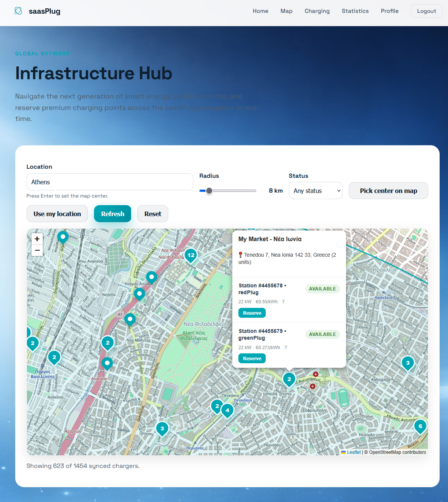
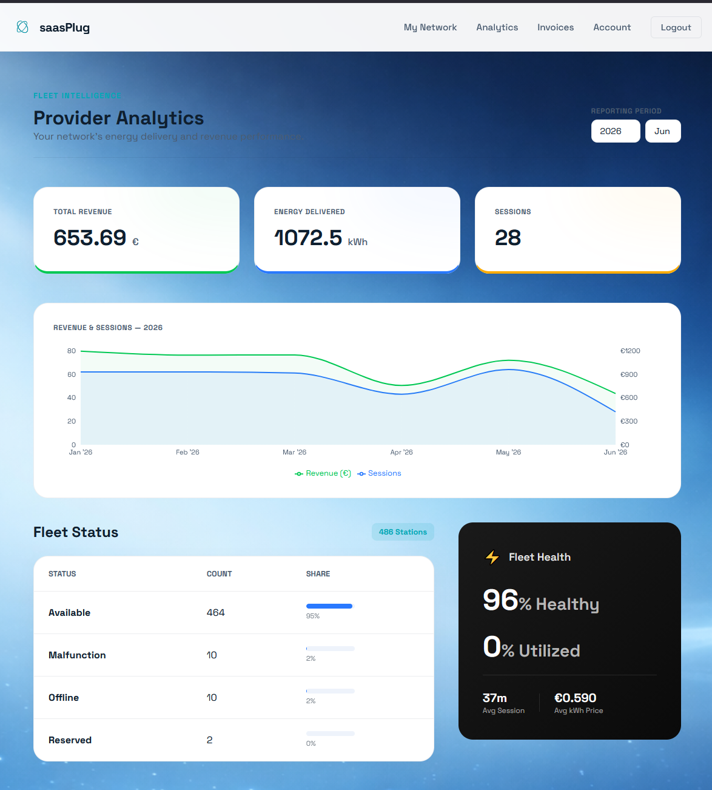

# saasPlug

### EV charging, powered by event-driven microservices

A full-stack platform for finding charging stations, reserving a charger,
monitoring sessions, and managing provider networks, analytics, and billing.
Built collaboratively for **NTUA ECE SaaS 2026 - Team 09**.


[Technologies](#technologies-used) · [Screenshots](#application-preview) ·
[Architecture](#architecture) · [Run locally](#run-locally) ·
[Development guide](docs/DEVELOPMENT.md)

## Technologies used

| Area | Technologies | Role in the project |
| --- | --- | --- |
| Frontend | **React 18**, **Vite**, React Router | Component-based web app, development tooling, and role-specific navigation. |
| Maps and dashboards | **Leaflet**, React Leaflet, **Recharts**, Framer Motion | Interactive charger maps, usage charts, and UI animation. |
| API client | **Axios** | HTTP requests from the web app to the API Gateway. |
| Backend | **Node.js**, **Express 5**, JavaScript ES modules | Independent REST services for authentication, users, charging, reservations, providers, analytics, administration, and billing. |
| Persistence | **MongoDB**, **Mongoose** | Service-owned databases, schemas, and queries. |
| Messaging | **RabbitMQ**, amqplib | Event-based communication and synchronization across services. |
| Authentication | **JWT**, jsonwebtoken, bcrypt | Access tokens, role checks, and password hashing. |
| API Gateway | **Nginx** | A single public entrypoint, request routing, rate limiting, and frontend serving. |
| Containers | **Docker**, **Docker Compose** | Containerized services, private networking, and local/demo environments. |
| Testing and tooling | **Node.js test runner**, **Python / pytest**, ESLint | Integration and scenario tests, setup automation, and JavaScript linting. |
| Design documentation | **Visual Paradigm** | Editable UML architecture models and exported diagrams. |

Explore the [frontend dependencies](apps/web-app/package.json),
[backend dependencies](services/auth-service/package.json),
[Compose configuration](docker-compose.yml), and
[integration tests](tests/integration) for the implementation behind the stack.

## What the platform does

| Role | Main workflows |
| --- | --- |
| Driver | Find and filter charging stations on a map; reserve or cancel a charging slot; monitor a session; review usage statistics and manage a profile. |
| Provider | Manage a charging network; inspect charger status, energy, revenue, and utilization; review invoices and session details. |
| Administrator | Manage users and providers; monitor service health; inspect platform-wide analytics and billing. |

## Application preview

<table>
  <tr>
    <th>Charger discovery and reservations</th>
    <th>Provider analytics</th>
  </tr>
  <tr>
    <td><a href="app_screenshots/user_map_reserve.png"></a></td>
    <td><a href="app_screenshots/provider_analitics_page.png"></a></td>
  </tr>
</table>

**[View the complete gallery: 12 application screenshots →](app_screenshots/README.md)**

The gallery covers the landing page, sign-in, maps, reservations, charging
sessions, driver statistics, provider networks, and invoices.

## Architecture

The React web app sends `/api/*` requests through the **Nginx API Gateway**.
Backend services own their data and coordinate through **RabbitMQ events**.
Dedicated **BluePlug, RedPlug, and GreenPlug adapters** translate external
charging-network APIs into a common platform model.

| Services | Responsibility |
| --- | --- |
| [Auth](services/auth-service) and [User](services/user-service) | Sign-in, registration, tokens, and user profiles. |
| [Charger](services/charger-service) and [Reservation](services/reservation-service) | Station discovery and reservation/session lifecycle. |
| [Provider](services/provider-service) and [Plug](services/plug-service) | Provider records, polling, and charger synchronization through [provider adapters](services/plug-adapters). |
| [Analytics](services/analytics-service) and [Billing](services/billing-service) | Usage reporting, provider metrics, and invoices. |
| [Admin](services/admin-service) | Administrative operations and system-health views. |

Implementation details include role-based access, event consumers with
dead-letter handling, and a default Compose configuration that exposes the
API Gateway while keeping backend services and databases on internal networks.

[**Explore the architecture guide and diagram index →**](architecture/README.md)

The guide links to the complete architecture PDF, a component-diagram preview,
and the editable Visual Paradigm project. Diagrams document a design snapshot;
the service code and Compose configuration describe the current implementation.

## Run locally

Requires **Docker with Docker Compose**, **Python 3**, and **Node.js with npm**.

```bash
git clone https://github.com/billakos9/SaaS-Plug-2026-microservices.git
cd SaaS-Plug-2026-microservices
python3 scripts/setup-vm.py --team 09
```

Open **[http://localhost:3309](http://localhost:3309)** after setup completes.
The script creates runtime configuration, builds the frontend and containers,
and seeds the demo data.

A fresh setup resets the project's Docker volumes. For an existing installation,
use `--no-wipe` to keep its data, or `--rebuild` for a frontend/gateway rebuild.

For development mode, test commands, demo accounts, and port configuration,
see the [development guide](docs/DEVELOPMENT.md) and
[setup-script documentation](scripts/README.md).

## Explore the repository

| Directory | Contents |
| --- | --- |
| [`apps/`](apps) | React frontend and Nginx API Gateway. |
| [`services/`](services) | Backend services, provider adapters, and demo seeder. |
| [`tests/`](tests) | Integration tests and application scenarios. |
| [`architecture/`](architecture) | UML project, architecture PDF, and diagram guide. |
| [`app_screenshots/`](app_screenshots) | Full application gallery. |
| [`scripts/`](scripts) | Environment setup and seed automation. |
| [`docs/`](docs) | Development and deployment guide. |

## Team and showcase credits

This application is the collaborative work of **NTUA ECE SaaS 2026, Team 09**.
Original commit authorship is preserved in this repository's Git history.

The application screenshots and architecture PDF were reused from teammate
[Konstantinos (@konstantinosg5)](https://github.com/konstantinosg5)'s
[project showcase](https://github.com/konstantinosg5/SaaS-Plug-2026-microservices),
at [source commit `db1f238`](https://github.com/konstantinosg5/SaaS-Plug-2026-microservices/commit/db1f238857bb14eb43923b95512f15d577c0a3c4).
The supplied screenshots and PDF are retained unchanged. The architecture
preview is rendered from that PDF.

See [LICENSE](LICENSE) for the existing MIT license and copyright notice.
