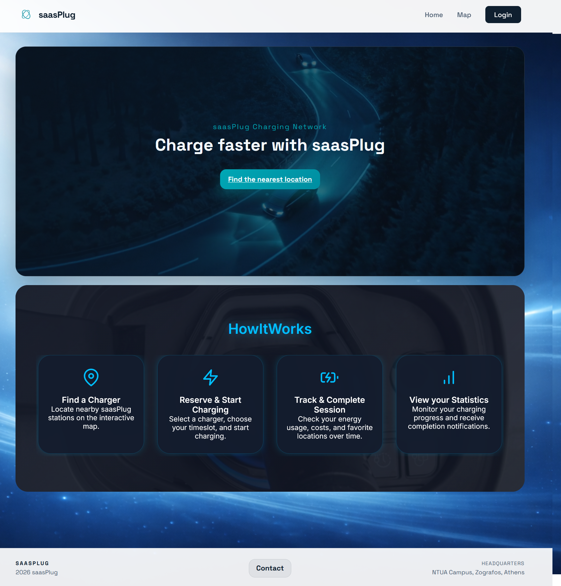
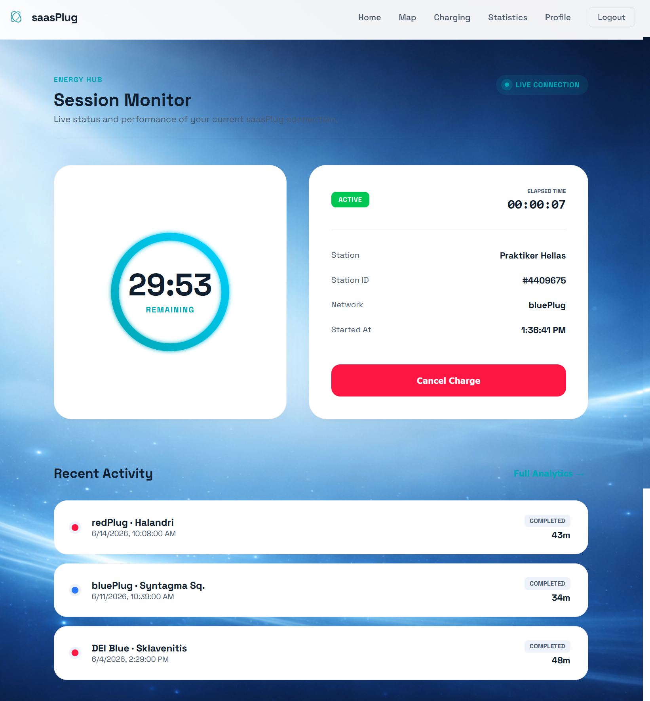

# saasPlug

**An EV charging platform built with event-driven microservices.**

Find a charger, reserve a charging slot, follow an active session, and explore
usage statistics. Providers manage their charging networks, analytics, and
invoices through a dedicated dashboard.

Developed collaboratively for **NTUA ECE SaaS 2026, Team 09**. This personal
repository preserves the team's original development history.

[Application gallery](app_screenshots/README.md) ·
[Architecture diagrams (PDF)](architecture/VPP_diagrams_architecture.pdf) ·
[Architecture guide](architecture/README.md) ·
[Run locally](#compose-modes) ·
[Team and credits](#team-and-showcase-credits)

## Product showcase

<table>
  <tr>
    <th>Welcome to saasPlug</th>
    <th>Find and reserve a charger</th>
  </tr>
  <tr>
    <td><a href="app_screenshots/home_screen.png"></a></td>
    <td><a href="app_screenshots/user_map_reserve.png"></a></td>
  </tr>
  <tr>
    <th>Follow a charging session</th>
    <th>Understand provider performance</th>
  </tr>
  <tr>
    <td><a href="app_screenshots/user_session_page.png"></a></td>
    <td><a href="app_screenshots/provider_analitics_page.png"></a></td>
  </tr>
</table>

[Explore all 12 application screenshots →](app_screenshots/README.md)

## Features

- **Drivers:** discover stations on a map, filter chargers, reserve a slot, and
  monitor charging sessions, history, and personal statistics.
- **Providers:** manage a charging network, inspect usage and revenue analytics,
  and review invoices and their session details.
- **Administrators:** manage users and providers, monitor system health, and
  inspect platform-wide analytics.
- **Integration:** normalize BluePlug, RedPlug, and GreenPlug through dedicated
  adapters, with RabbitMQ events connecting the services.

## Technology and architecture

| Layer | Technologies |
| --- | --- |
| Web app | React 18, Vite, React Router, Leaflet, Recharts, Framer Motion |
| Services | Node.js, Express, Mongoose, JWT authentication |
| Data and messaging | MongoDB, RabbitMQ |
| Gateway and deployment | Nginx, Docker, Docker Compose |
| Validation | Node.js integration tests, ESLint |

The React application reaches the services through the Nginx API Gateway.
Services keep separate data stores and use RabbitMQ for event-based
communication. Provider adapters translate external charging-network APIs into
the platform's shared model.

The [17-page architecture PDF](architecture/VPP_diagrams_architecture.pdf)
covers use cases, service components, deployment, interfaces, data models,
sequence diagrams, and activity diagrams. The
[architecture guide](architecture/README.md) provides a page index and a preview;
the editable Visual Paradigm project is included alongside the PDF.

## Repository Layout

```text
apps/
  api-gateway/          Nginx public entrypoint for frontend and /api/*
  web-app/              Current React/Vite frontend

services/
  auth-service/         Login, registration, JWT issuance, auth events
  user-service/         User profile read/update and user mirror data
  admin-service/        Admin management, system health, cross-service views
  provider-service/     Provider network records
  charger-service/      Charger/station catalog
  reservation-service/  Reservation lifecycle and session events
  analytics-service/    Provider/global analytics from reservation events
  billing-service/      Provider invoices and billing snapshots
  plug-service/         Polls provider adapters and publishes charger updates
  plug-adapters/        bluePlug, redPlug, greenPlug provider adapters
  dev-seeder/           Seeds auth/user data from mock_data/users.json

app_screenshots/       Application gallery and original team screenshots
mock_data/              Seed input data
scripts/                Local dev and Softlab VM setup scripts
architecture/           Diagram PDF, preview, and editable Visual Paradigm project
tests/                  Node integration tests
```

## Public Entrypoint

The canonical public entrypoint is the API Gateway:

```text
http://localhost:<public-port>
```

Public API paths are under `/api/*`, for example:

```text
/api/auth/login
/api/chargers/
/api/reservations
/api/users/me
/api/admin/system-health
```

Backend services communicate internally over the Docker network by service name,
for example `auth-service:3000`.

## Compose Modes

### Production-like / VM mode

The default compose file exposes only the API Gateway. Services, databases,
RabbitMQ, and adapters are internal-only.

For the Softlab Team 09 port:

```bash
PUBLIC_HTTP_PORT=3309 docker compose up -d --build
```

The web app is available locally at:

```text
http://localhost:3309
```

The API is available at:

```text
http://localhost:3309/api
```

### Local dev/debug mode

Use this only when you need direct host access to services, MongoDBs, RabbitMQ,
or adapters:

```bash
docker compose -f docker-compose.yml -f docker-compose.dev.yml up -d --build
```

Direct dev ports include:

```text
user-service        3001
auth-service        3002
reservation-service 3003
charger-service     3004
analytics-service   3005
provider-service    3006
admin-service       3007
plug-service        3008
adapters            3009-3011
billing-service     3012
RabbitMQ UI         15672
MongoDBs            27011-27016, 27021-27022
```

## Softlab VM Setup

On the Softlab VM:

```bash
git pull
python3 scripts/setup-vm.py --team 09
```

For a frontend/gateway rebuild without DB wipe/seed:

```bash
python3 scripts/setup-vm.py --team 09 --rebuild
```

The app should be visible inside the Softlab network at:

```text
http://147.102.112.123:3309
```

`setup-vm.py` generates:

```text
docker-compose.override.yml
apps/api-gateway/nginx.vm.conf
apps/web-app/dist/
```

These files are generated locally and ignored by git.

## Web App Development

Install and run Vite:

```bash
cd apps/web-app
npm install
npm run dev
```

The Vite proxy reads `PUBLIC_HTTP_PORT` from the root `.env`. If the gateway is
running on `3309`, `/api` requests from Vite are proxied to
`http://localhost:3309` automatically.

## Test Accounts

All seeded passwords are `123456`.

Users:

```text
giorgos.papadopoulos@gmail.com
james.smith@gmail.com
marco.rossi@gmail.com
```

Providers:

```text
blue@plug.com
red@plug.com
green@plug.com
```

Admins:

```text
admin@saas.com
admin@saasplug.app
agrinios@saasplug.app
```

## Tests

Root integration tests:

```bash
npm test
```

Focused examples:

```bash
npm run test:admin
npm run test:reservation
npm run test:analytics
```

Web app build:

```bash
npm --prefix apps/web-app run build
```

Compose validation:

```bash
docker compose config -q
docker compose -f docker-compose.yml -f docker-compose.dev.yml config -q
```

## Notes

- `JWT_SECRET` must be set explicitly. Do not rely on backend default secrets.
- Browser auth tokens are stored in `sessionStorage`.
- Public registration creates normal users only.
- Admin accounts are seeded or managed by admins, not public registration.
- Provider self-registration is guarded by `PROVIDER_REGISTRATION_CODE`.

## Team and showcase credits

This application is the collaborative work of **NTUA ECE SaaS 2026, Team 09**.
Original commit authorship is preserved in this repository's Git history.

The application screenshots and architecture PDF were reused from teammate
[Konstantinos (@konstantinosg5)](https://github.com/konstantinosg5)'s
[project showcase](https://github.com/konstantinosg5/SaaS-Plug-2026-microservices),
at [source commit `db1f238`](https://github.com/konstantinosg5/SaaS-Plug-2026-microservices/commit/db1f238857bb14eb43923b95512f15d577c0a3c4).
The supplied screenshots and PDF are retained unchanged. The architecture
preview is rendered from that PDF.

See [LICENSE](LICENSE) for the existing MIT license and copyright notice.
