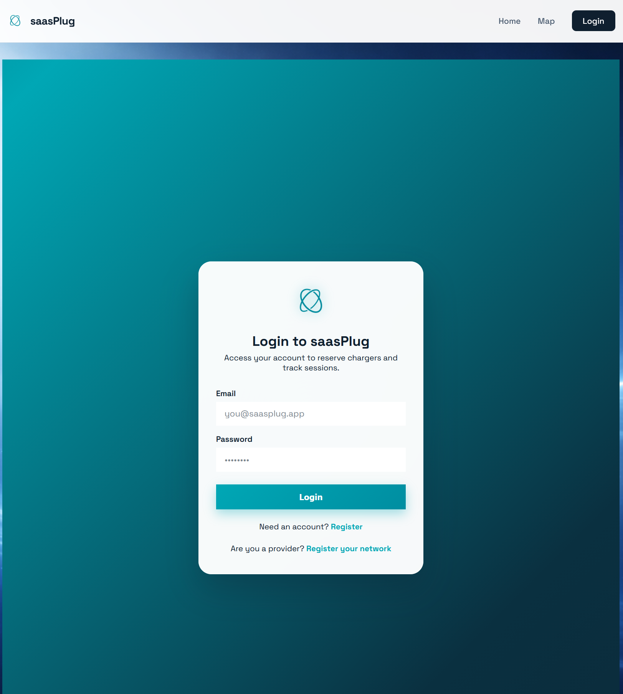
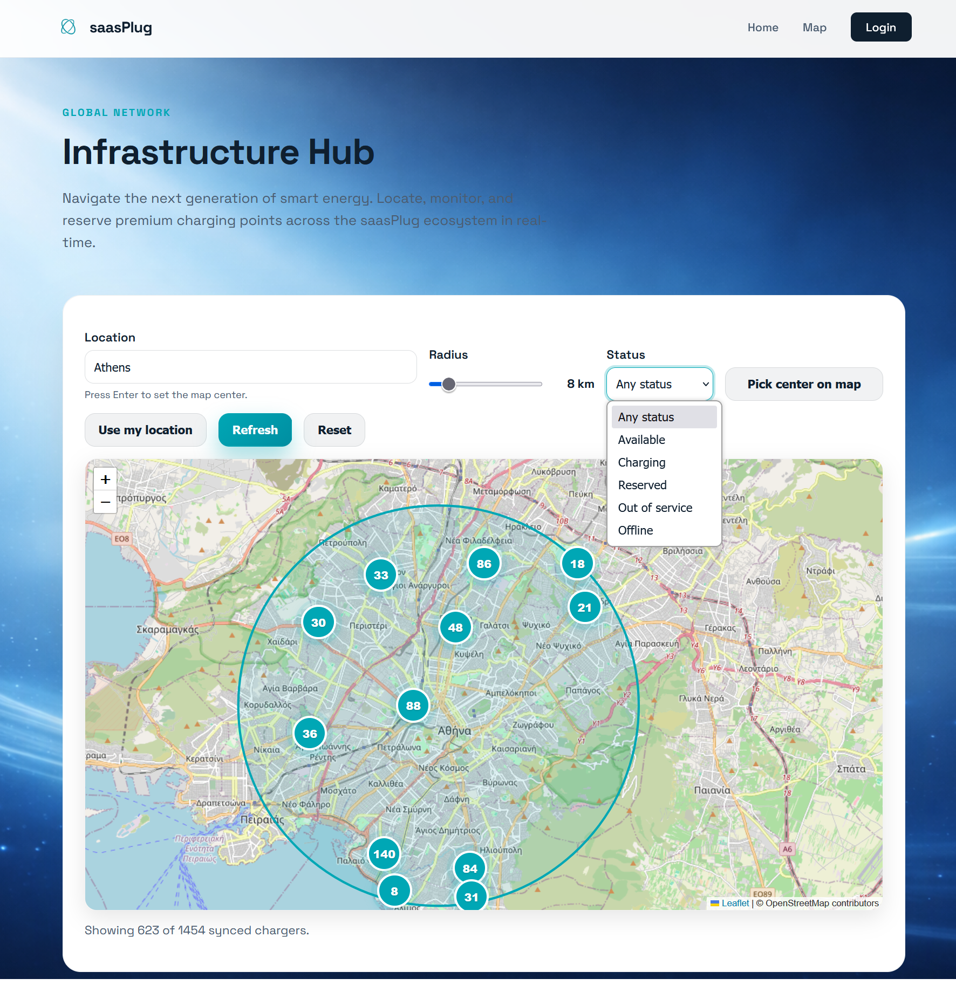
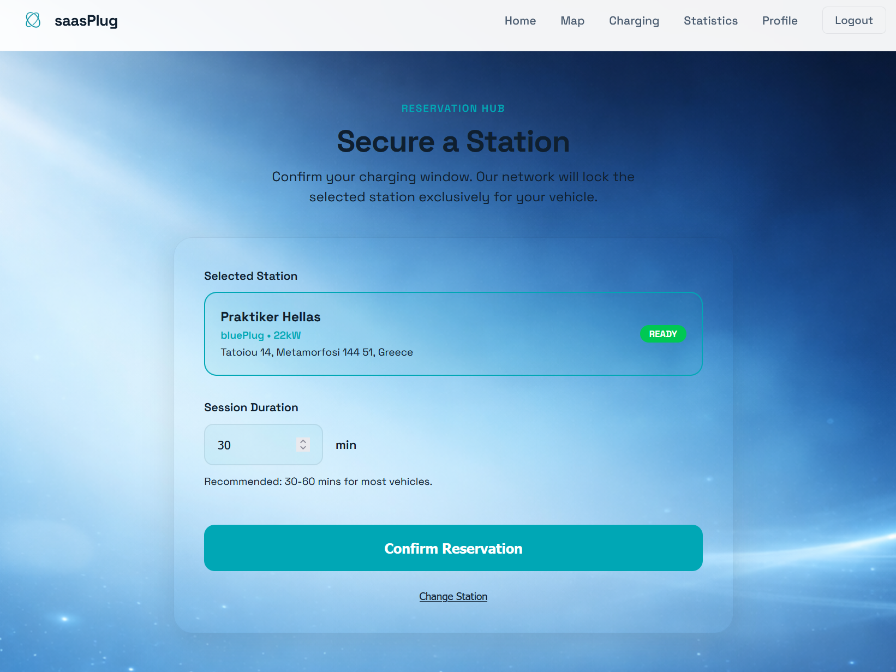
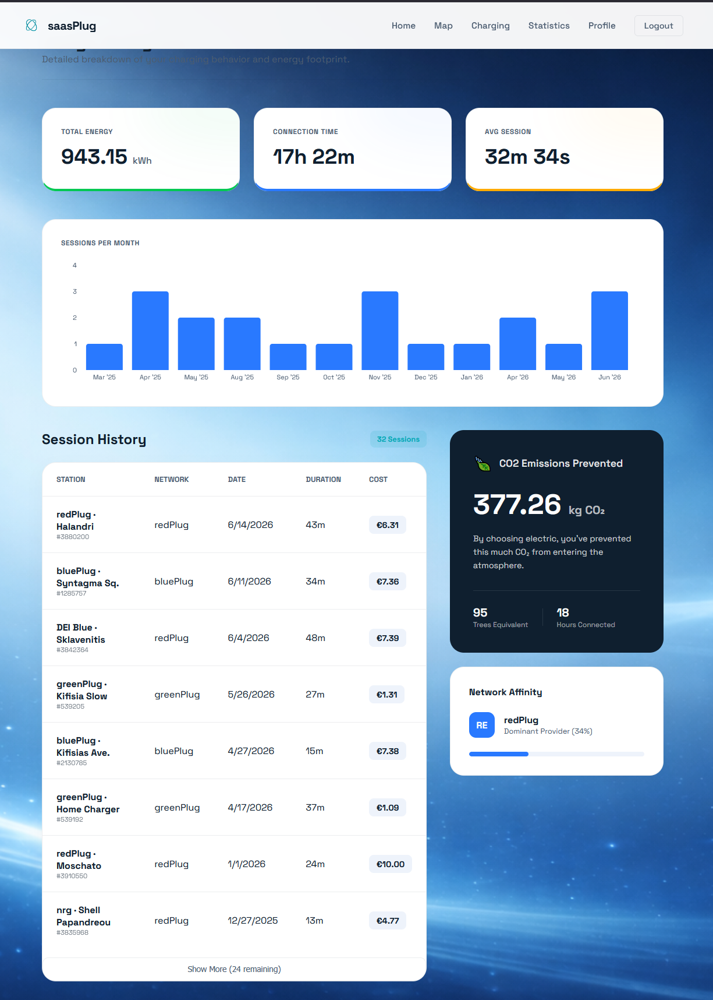
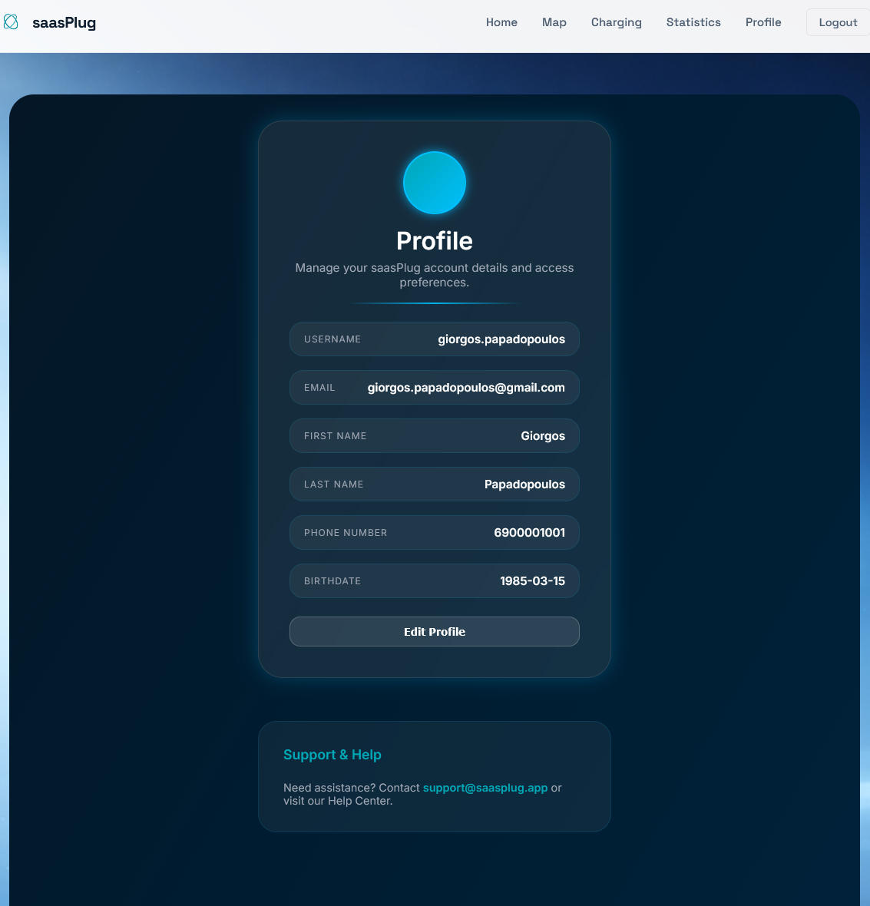
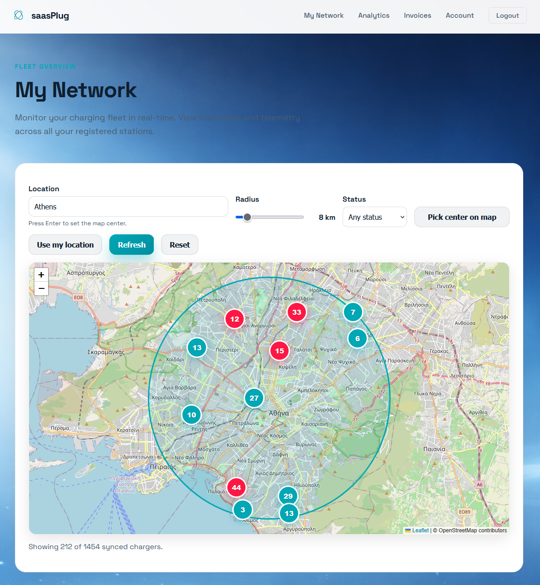
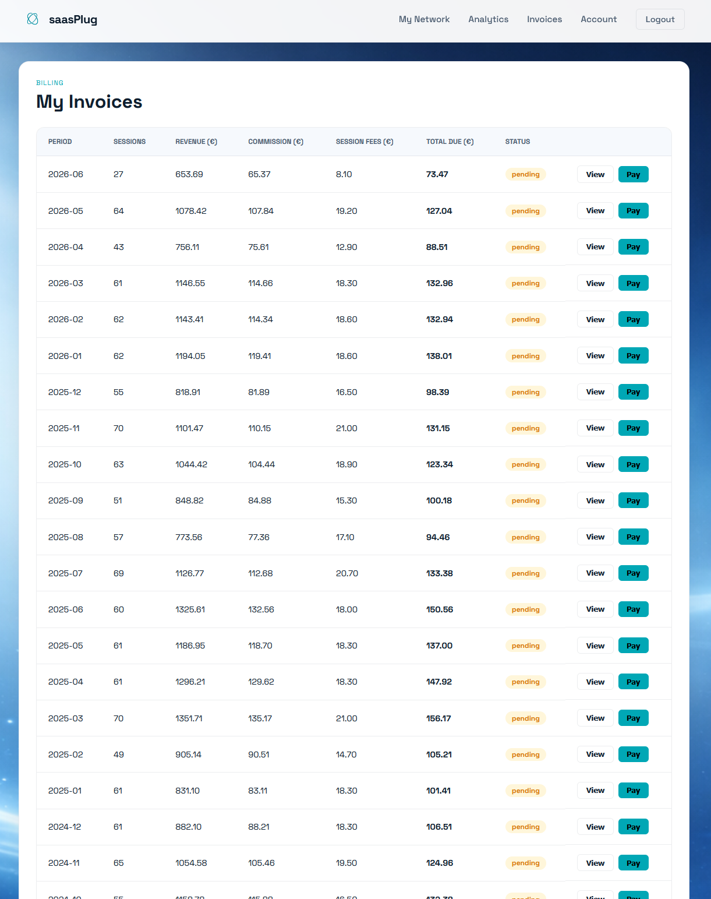
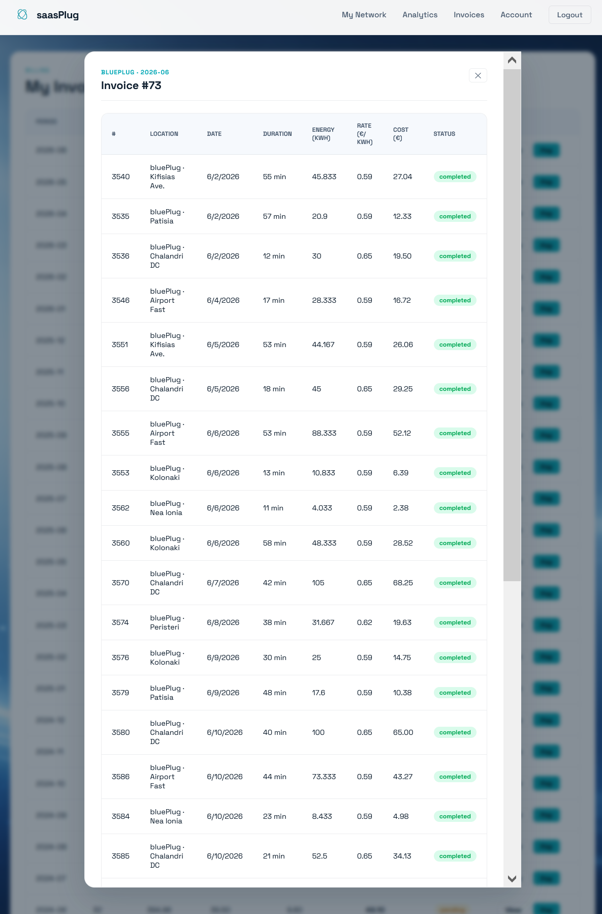

# Application gallery

A walkthrough of saasPlug's driver and provider interfaces, captured for the
Team 09 demo. Select any image to open the original at full resolution.

[Project overview](../README.md) · [Architecture guide](../architecture/README.md)

## Welcome and sign-in

<table>
  <tr>
    <th>Home</th>
    <th>Sign in</th>
  </tr>
  <tr>
    <td></td>
    <td></td>
  </tr>
  <tr>
    <td>Landing page introducing the charging workflow.</td>
    <td>Sign-in screen for the application.</td>
  </tr>
</table>

## Discover and choose a charger

<table>
  <tr>
    <th>Charger discovery</th>
    <th>Station details</th>
  </tr>
  <tr>
    <td></td>
    <td></td>
  </tr>
  <tr>
    <td>Map with location, radius, and availability filters.</td>
    <td>Selected station with charger details and a reservation action.</td>
  </tr>
</table>

## Reserve and charge

<table>
  <tr>
    <th>Reservation</th>
    <th>Session monitor</th>
  </tr>
  <tr>
    <td></td>
    <td></td>
  </tr>
  <tr>
    <td>Choose a session duration and confirm a charging slot.</td>
    <td>Follow an active session and review recent activity.</td>
  </tr>
</table>

## Driver account and statistics

<table>
  <tr>
    <th>Usage statistics</th>
    <th>Driver profile</th>
  </tr>
  <tr>
    <td></td>
    <td></td>
  </tr>
  <tr>
    <td>Energy, session history, and charging statistics.</td>
    <td>Account information and profile settings.</td>
  </tr>
</table>

## Provider network and analytics

<table>
  <tr>
    <th>My network</th>
    <th>Provider analytics</th>
  </tr>
  <tr>
    <td></td>
    <td></td>
  </tr>
  <tr>
    <td>Provider fleet map with charger availability.</td>
    <td>Revenue, energy, sessions, and fleet status.</td>
  </tr>
</table>

## Provider billing

<table>
  <tr>
    <th>Invoice list</th>
    <th>Invoice details</th>
  </tr>
  <tr>
    <td></td>
    <td></td>
  </tr>
  <tr>
    <td>Provider invoices by billing period and payment status.</td>
    <td>Detailed invoice view with its charging-session lines.</td>
  </tr>
</table>

## Source and credits

These 12 screenshots were supplied in teammate
[Konstantinos (@konstantinosg5)](https://github.com/konstantinosg5)'s
[Team 09 showcase](https://github.com/konstantinosg5/SaaS-Plug-2026-microservices/tree/db1f238857bb14eb43923b95512f15d577c0a3c4/app_screenshots).
They are copied unchanged from source commit `db1f238857bb14eb43923b95512f15d577c0a3c4`.
The application is a collaborative Team 09 project; this gallery does not assign
individual ownership of the features shown.
