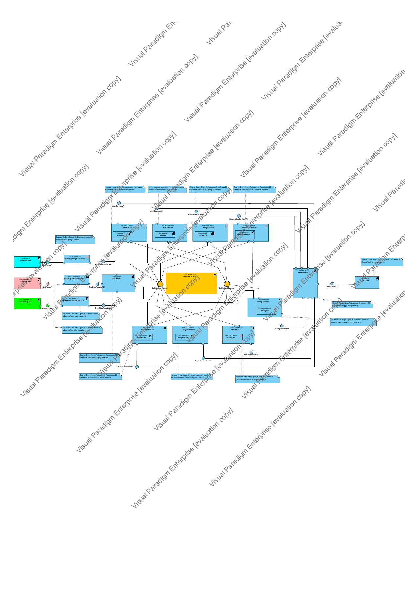

# Architecture

Design documentation for **saasPlug - NTUA ECE SaaS 2026, Team 09**.

[Project overview](../README.md) · [Application gallery](../app_screenshots/README.md)

## Browse the diagrams

- [Open the complete architecture PDF (17 pages)](VPP_diagrams_architecture.pdf)
- [Download the editable Visual Paradigm project](saasplug_26_09_fin.vpp)

| PDF page | Diagram |
| --- | --- |
| 1 | System use cases: driver, provider, and administrator |
| 2 | Service components, databases, gateway, and provider adapters |
| 3 | Deployment topology and infrastructure |
| 4 | Service API interfaces |
| 5 | Domain entities and relationships |
| 6 | Data transfer objects |
| 7 | Charger discovery sequence |
| 8 | Reservation and cancellation sequence |
| 9 | Administrator analytics and invoice sequence |
| 10 | Provider analytics sequence |
| 11 | Provider invoice detail sequence |
| 12 | Global analytics activity |
| 13 | Provider registration activity |
| 14 | Charger reservation activity |
| 15 | Charger discovery activity |
| 16 | Provider analytics activity |
| 17 | Provider invoicing activity |

## Component diagram preview

Select the preview to open the full PDF. This image is rendered from page 2
of the original export, with its existing watermarks retained.

[](VPP_diagrams_architecture.pdf)

## Relationship to the implementation

The PDF is a design snapshot. Some sequence and activity diagrams use earlier
route names or implementation notes. For current routes, service boundaries,
and deployment settings, consult:

```text
docker-compose.yml
docker-compose.dev.yml
apps/api-gateway/nginx.conf
services/*/src
```

## Source and credits

The architecture PDF was reused unchanged from teammate
[Konstantinos (@konstantinosg5)](https://github.com/konstantinosg5)'s
[Team 09 showcase](https://github.com/konstantinosg5/SaaS-Plug-2026-microservices/blob/db1f238857bb14eb43923b95512f15d577c0a3c4/architecture/VPP_diagrams_architecture.pdf),
at source commit `db1f238857bb14eb43923b95512f15d577c0a3c4`.
The editable `.vpp` project was already part of this repository. The architecture
and application are collaborative Team 09 work.
